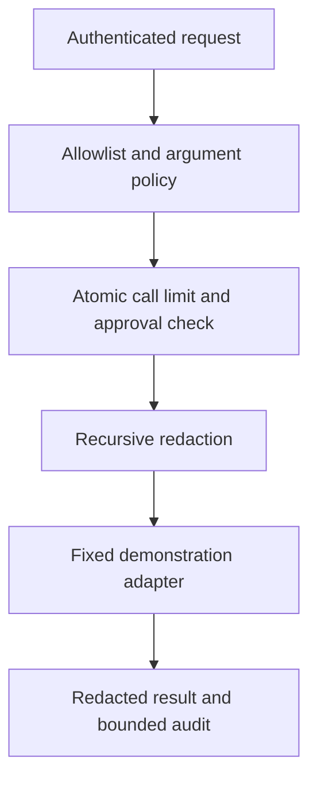

# AgentGate

**Inspect agent tool requests before execution.** An independent Python engineering project by Neeli Yaswanth Kumar.

[Interactive demonstration](https://kyaswanthneeli-stack.github.io/projects/agentgate.html) · [Portfolio](https://kyaswanthneeli-stack.github.io/)

## What this release implements

A FastAPI service with a fixed tool allowlist, argument validation, recursive email/key-pattern redaction, selected instruction-override detection, atomic per-session call limits, and request-bound one-use approvals. Client and administrator credentials are separate. The two tool adapters are intentionally local demonstrations: document search returns a fixture; notification execution returns a simulated result without sending anything.

This is a policy gateway prototype, **not a complete prompt-injection firewall or MCP proxy**. It has no trained local classifier, monetary budget accounting, arbitrary tool forwarding or production compliance certification.

## Run locally

```bash
git clone https://github.com/kyaswanthneeli-stack/agentgate.git
cd agentgate
python3 -m venv .venv
source .venv/bin/activate
pip install -r requirements.txt
export AGENTGATE_CLIENT_KEY="$(python -c 'import secrets; print(secrets.token_hex(32))')"
export AGENTGATE_ADMIN_KEY="$(python -c 'import secrets; print(secrets.token_hex(32))')"
uvicorn app:app --host 127.0.0.1 --port 8000 --workers 1
```

Open `http://127.0.0.1:8000/docs`. The interactive API documentation explains each input. Keep administrator credentials away from agents. Missing credentials fail closed.

In a second terminal with the same client environment variable:

```bash
curl http://127.0.0.1:8000/tools/call \
  -H "X-API-Key: $AGENTGATE_CLIENT_KEY" -H 'Content-Type: application/json' \
  -d '{"session":"demo","tool":"search_docs","arguments":{"query":"onboarding"}}'
```

### Approval walkthrough

1. Submit `send_notification` with `arguments: {"message":"Release ready"}` to `/tools/call`. It returns 403 without approval.
2. An administrator sends the **same session, tool and arguments** to `/approvals` with `X-Admin-Key`.
3. Copy the returned `approval` into the original tool request. Submit with the client key within 60 seconds.
4. Changing any bound field, reusing the approval or waiting past expiry causes rejection. Approval cannot override an unknown tool or blocked pattern.
5. `/audit` requires the administrator key. It returns successful execution metadata and request digests rather than raw arguments. Denied requests are not currently recorded.

## Architecture



A process-local lock protects counters and approval consumption. Approval tokens contain a random nonce and HMAC and are stored against a canonical request digest. An approval is valid only while present in this process's registry. Restarting invalidates tokens and resets counters.

## Verify

```bash
python -m unittest -v
```

14 tests cover authentication, policy denial, nested redaction, output redaction, concurrent limit enforcement, approval binding, replay, expiry and administrator separation. These are correctness checks for implemented controls, not evidence of comprehensive attack resistance.

## Deployment and limits

`docs/index.html` is a standalone public browser simulation. It does not call the Python API or implement its cryptographic approvals. A Dockerfile is included for a backend host; set both credentials at runtime and use a TLS reverse proxy. Do not publish these credentials in GitHub or frontend code.

Run **one worker only**: state is in memory, not shared or durable. Session identifiers are caller-selected, so a caller can evade a per-session cap by creating another session; this is not a tenant billing control. There are at most 1,000 active sessions/approvals and 1,000 retained audit events. Counts reset on restart. HTTP ingress size/rate limits and authenticated principal-to-session binding are deployment responsibilities. Regex checks miss obfuscated, multilingual and indirect attacks; PII redaction is incomplete. Request digests can still permit guessing of predictable input. No external tool execution is secured by this prototype.

Next steps: durable principal-bound quotas, an actual MCP adapter, security evaluation corpus, classifier comparison, denied-event auditing, approval UI and adversarial testing.
