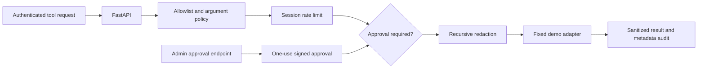

# Tool policy gateway: architecture and demo

## Architecture

## Recruiter walkthrough (five minutes)

Demonstrate 401 for no client key, 403 for a disallowed tool, allowed search_docs results, request-bound approval for send_notification, failed approval replay, and the 14 unit tests.

Run `python -m unittest -v` on the actual Python service. Show `GET /health`, `GET /docs`, and a successful authenticated example using synthetic data. If recording, use disposable keys and no private source information.

## Railway deployment

1. Connect this exact GitHub repository to a Railway service. The checked-in `railway.json` selects its Dockerfile and `/health` check.
2. Assign the host the listening service port 8000; set `PORT=8000` if required by your Railway networking configuration.
3. AGENTGATE_CLIENT_KEY and AGENTGATE_ADMIN_KEY must be distinct random server-side keys. Keep one worker because counters and approvals are in memory.
4. Attach a public HTTPS domain, wait for a passing health check, and test with `curl https://YOUR_HOST/health`.
5. Set hosting ingress limits and observability before sharing broadly. Never include secrets in GitHub Pages or a demo video.

## Accurate scope and limitations

No real email or arbitrary tool forwarding. The public Pages demo is a simulation. This is not a production-grade prompt-injection firewall.
